# 测昊-工业自动化测试工作站软件使用文档CH_V02

适用软件：CeHao / 测昊工业自动化测试工作站  
当前版本：CH_V02  
适用对象：操作员、班组长、工程师、管理员  
文档日期：2026-07-09

## 1. 软件概述

测昊工业自动化测试工作站用于产线自动化测试工站，主要完成扫码、条码规则校验、下位机通讯、测试项目显示、PASS/FAIL 判定、MES 卡关与上传、测试结果导出、良率统计和异常提示。

日常生产通常按以下顺序操作：

1. 登录系统。
2. 导入或确认客户方案。
3. 确认基础配置、通讯设置、MES 配置和插件配置。
4. 连接扫码枪、下位机，必要时切换 MES 在线模式。
5. 扫码或触发测试。
6. 查看测试结果、失败项、良率和运行日志。
7. 系统按配置自动导出结果文件并上传 MES。

## 2. 登录界面

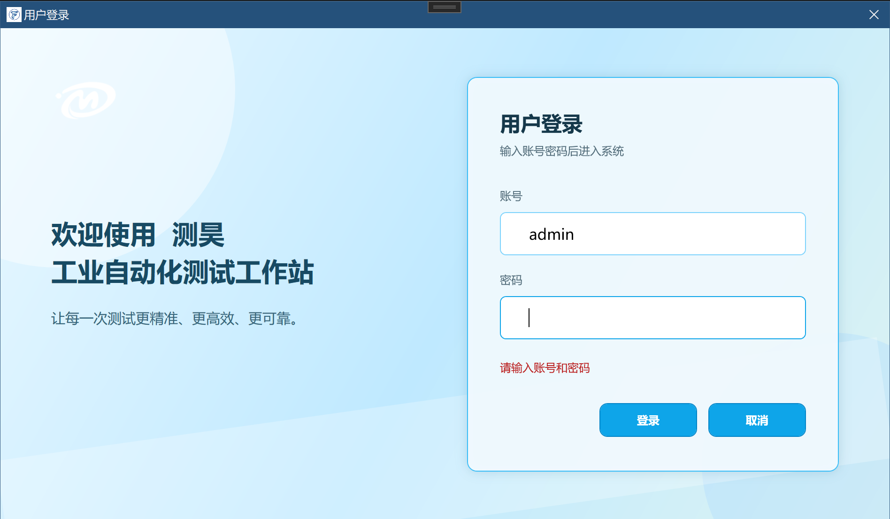

### 重点功能

| 功能/配置 | 说明 |
| --- | --- |
| 账号 | 输入登录账号。默认账号包含 `operator`、`engineer`、`admin`。 |
| 密码 | 输入账号密码。默认密码分别为 `123456`、`123`、`admin`，现场可在用户配置中修改。 |
| 登录 | 校验账号密码，通过后进入主界面。 |
| 取消 | 取消登录并关闭登录窗口。 |
| 错误提示 | 账号或密码为空、错误时，会在登录框下方显示红色提示。 |

### 权限说明

| 角色 | 主要权限 |
| --- | --- |
| Operator 操作员 | 日常生产、查看主界面、查看运行数据。 |
| Engineer 工程师 | 可维护基础配置、通讯设置、MES 配置、插件配置。 |
| Administrator 管理员 | 拥有全部权限，包括用户配置、导入客户方案、管理员工具。 |

## 3. 主界面

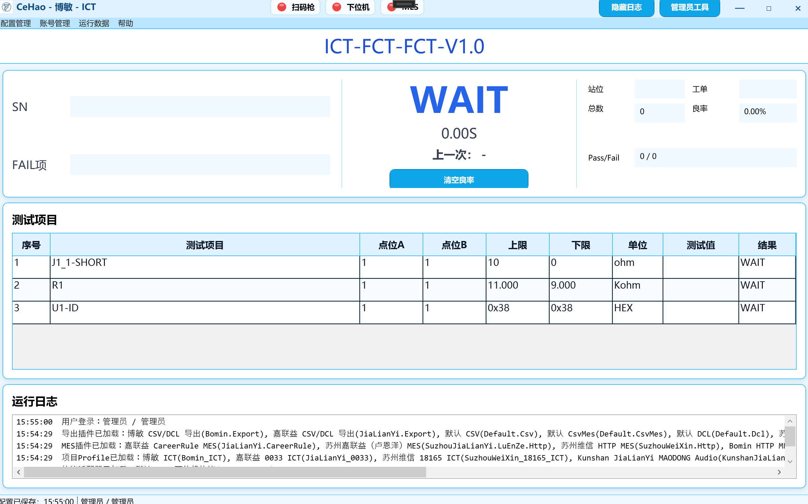

主界面是操作员日常使用最多的页面，用于查看设备状态、扫码结果、测试状态、测试项目、良率和日志。

### 3.1 顶部状态与菜单

| 区域/按钮 | 说明 |
| --- | --- |
| 窗口标题 | 显示当前软件名称、客户和产品，例如 `CeHao - 博敏 - ICT`。 |
| 扫码枪状态灯 | 显示扫码枪连接状态。点击可连接或断开扫码枪。红色表示未连接，绿色表示已连接，黄色表示禁用或离线类状态。 |
| 下位机状态灯 | 显示下位机连接状态。点击可连接或断开下位机。 |
| MES 状态灯 | 显示 MES 状态。点击可在在线/离线之间切换。 |
| 隐藏日志/显示日志 | 控制底部运行日志是否显示。日志较多时可隐藏以扩大测试项目区域。 |
| 管理员工具 | 管理员账号可见，提供初始化、模拟扫码、模拟 PASS/FAIL 等调试功能。 |
| 配置管理 | 打开基础配置、通讯设置、MES 配置、插件配置、测试项配置、客户方案导入等页面。 |
| 账号管理 | 打开用户配置或切换登录。 |
| 运行数据 | 打开数据分析页面。 |
| 帮助 | 打开软件帮助和版本说明。 |

### 3.2 当前测试信息

| 字段/按钮 | 说明 |
| --- | --- |
| SN | 当前产品条码。扫码成功后显示在此处。 |
| FAIL项 | 最近一次失败项目及失败值。用于快速定位不良项。 |
| WAIT / SCAN / READY / TEST / PASS / FAIL | 当前测试状态。WAIT 表示等待，SCAN 表示等待扫码，READY 表示已准备，TEST 表示测试中，PASS/FAIL 表示测试完成。 |
| 测试耗时 | 显示本次测试耗时，单位秒。 |
| 上一次 | 显示上一片产品结果。 |
| 清空良率 | 清空本次 PASS、FAIL、总数、连续 NG 和本次运行记录。换线、换工单或重新统计前使用。 |
| 站位 | 当前站位编号。 |
| 工单 | 当前生产工单。 |
| 总数 | 本次统计的测试总数。 |
| 良率 | PASS 数 / 总数。 |
| Pass/Fail | 当前 PASS 数和 FAIL 数。 |

### 3.3 测试项目表

| 列名 | 说明 |
| --- | --- |
| 序号 | 测试项目顺序。 |
| 测试项目 | 测试项目名称。 |
| 点位A / 点位B | 测试点位信息。 |
| 上限 / 下限 | 判定上下限。主界面中上下限可直接编辑，失去焦点后保存。 |
| 单位 | 测试单位。 |
| 测试值 | 下位机返回的实际测试值。 |
| 结果 | 项目判定结果。OK 通常显示为绿色，NG 通常显示为红色。 |

### 3.4 运行日志

运行日志记录系统启动、登录、插件加载、客户方案加载、设备连接、扫码、MES 卡关、测试结果、导出结果、上传结果和报警信息。现场排查异常时，应优先查看最近几条日志。

### 3.5 管理员工具

管理员工具仅管理员账号可见。

| 按钮 | 说明 |
| --- | --- |
| 初始化 | 重置测试流程并重新加载测试项。 |
| 模拟DM | 模拟下位机发送启动信号。 |
| 模拟扫码 | 生成模拟条码并触发扫码流程。 |
| 模拟PASS | 使用示例 PASS 数据完成一次测试。 |
| 模拟FAIL | 使用示例 FAIL 数据完成一次测试。 |

## 4. 导入客户方案

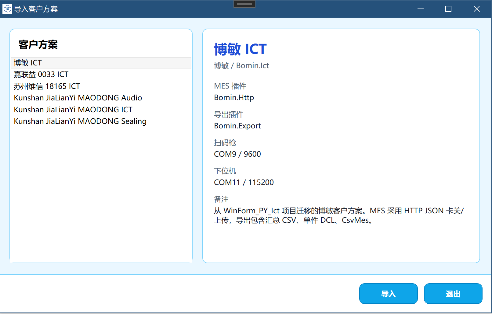

路径：配置管理 > 项目基础 > 导入客户方案

客户方案用于快速切换客户、产品、通讯、MES、导出插件和测试项等配置。换线、换客户、换产品时优先使用此功能。

| 区域/按钮 | 说明 |
| --- | --- |
| 客户方案列表 | 显示当前可导入的项目方案，例如博敏 ICT、嘉联益 0033 ICT、苏州维信 18165 ICT 等。 |
| 方案标题 | 显示选中方案的客户和产品。 |
| MES 插件 | 显示该方案使用的 MES 插件，例如 `Bomin.Http`。 |
| 导出插件 | 显示该方案使用的结果导出插件，例如 `Bomin.Export`。 |
| 扫码枪 | 显示扫码枪通讯配置摘要，例如 `COM9 / 9600`。 |
| 下位机 | 显示下位机通讯配置摘要，例如 `COM11 / 115200`。 |
| 备注 | 显示该方案来源、接口格式、导出格式等说明。 |
| 导入 | 导入选中方案。导入后系统会应用该方案配置，并默认将 MES 在线模式置为离线，避免误连生产 MES。 |
| 退出 | 取消导入。 |

操作建议：导入方案后，先检查基础配置、通讯设置、MES 配置和插件配置，再连接设备开始生产。

## 5. 基础配置

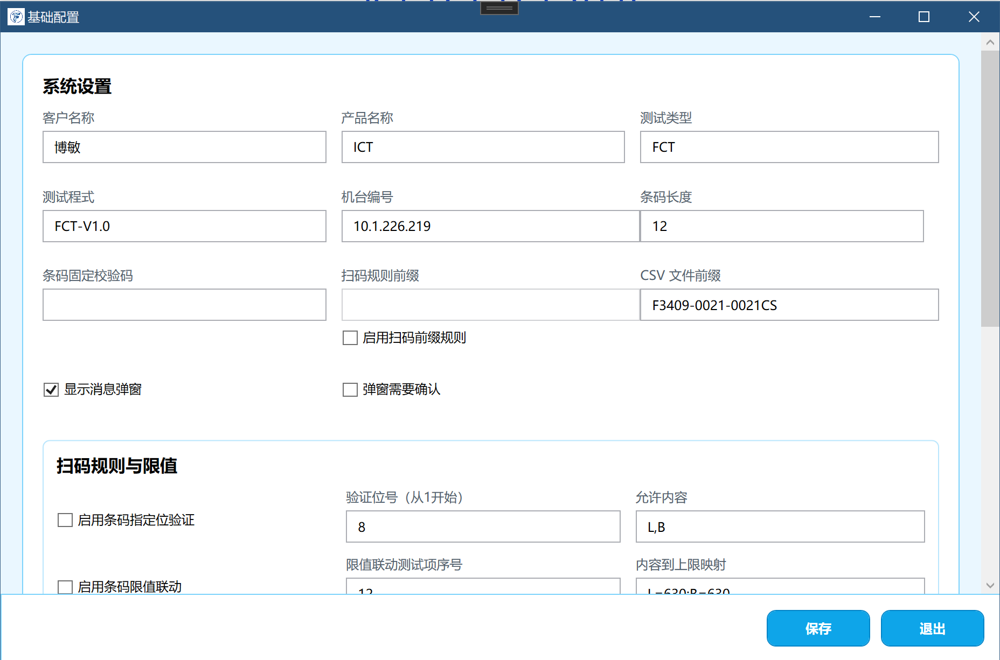

路径：配置管理 > 项目基础 > 基础配置

基础配置用于维护客户、产品、测试类型、条码规则、CSV 文件名前缀、弹窗和保存路径。

### 5.1 系统设置

| 配置项 | 说明 |
| --- | --- |
| 客户名称 | 当前客户名称，影响窗口标题、方案显示和部分导出字段。 |
| 产品名称 | 当前产品名称，影响主界面标题、MES 参数和导出文件。 |
| 测试类型 | 当前测试类别，例如 ICT、FCT、Audio、Sealing。应与 MES 和客户方案一致。 |
| 测试程式 | 当前测试程序版本，例如 `FCT-V1.0`。 |
| 机台编号 | 设备编号或机台 IP，部分 MES/导出插件会作为设备字段使用。 |
| 条码长度 | 条码应有长度。扫码时系统按此长度校验。 |
| 条码固定校验码 | 用于固定码或模拟条码校验。无要求可留空。 |
| 扫码规则前缀 | 需要限制条码前缀时填写。 |
| 启用扫码前缀规则 | 开启后，条码必须匹配扫码规则前缀。 |
| CSV 文件前缀 | 默认 CSV 文件名前缀。 |
| 显示消息弹窗 | 开启后，测试完成、报警或异常会弹出提示。 |
| 弹窗需要确认 | 开启后，操作员必须点击确认，流程才继续。 |

### 5.2 扫码规则与限值

| 配置项 | 说明 |
| --- | --- |
| 启用条码指定位验证 | 开启后检查条码指定位置的字符是否在允许范围内。 |
| 验证位号（从1开始） | 指定检查条码第几位，例如 `8` 表示第 8 位。 |
| 允许内容 | 指定位允许内容，多个值可用逗号分隔，例如 `L,B`。 |
| 启用条码限值联动 | 开启后可根据条码某位内容自动调整某个测试项的上下限。 |
| 限值联动测试项序号 | 指定要被联动修改限值的测试项目序号。 |
| 内容到上限映射 | 不同条码内容对应不同上限，例如 `L=630;B=630`。 |
| 内容到下限映射 | 不同条码内容对应不同下限，例如 `L=550;B=480`。 |

### 5.3 底部按钮

| 按钮 | 说明 |
| --- | --- |
| 保存 | 保存本页配置并返回主界面。 |
| 退出 | 放弃本次修改。 |

## 6. 通讯设置

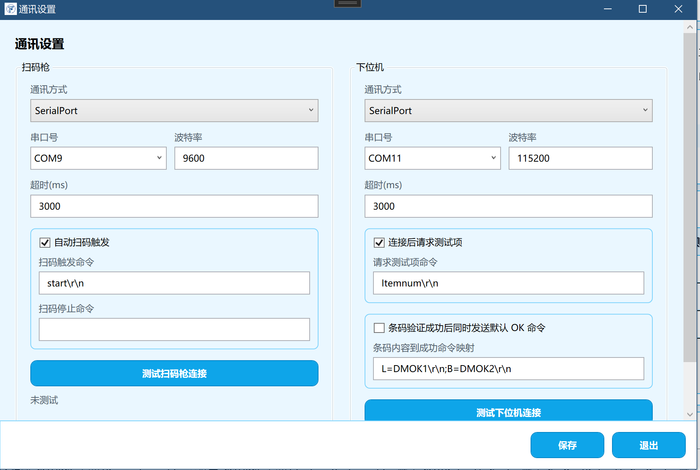

路径：配置管理 > 设备通讯 > 扫码枪 / 下位机通讯

通讯设置用于维护扫码枪和下位机的串口/TCP 连接参数。

### 6.1 通讯方式

| 通讯方式 | 说明 |
| --- | --- |
| SerialPort | 串口通讯，需要配置串口号和波特率。 |
| TcpClient | 本软件作为客户端连接设备，需要配置设备 IP 和端口。 |
| TcpServer | 本软件作为服务端等待设备连接，需要配置监听 IP 和端口。 |
| Disabled | 禁用该设备，不建立连接。 |

### 6.2 扫码枪区域

| 配置项/按钮 | 说明 |
| --- | --- |
| 通讯方式 | 选择扫码枪连接方式。 |
| 串口号 | 串口模式下选择扫码枪 COM 口。 |
| 波特率 | 串口通讯速率，例如 9600。 |
| 超时(ms) | 连接或通讯超时时间。 |
| 自动扫码触发 | 开启后，系统会主动向扫码枪发送触发命令。 |
| 扫码触发命令 | 触发扫码的命令，支持 `\r\n`。 |
| 扫码停止命令 | 停止扫码的命令，无要求可留空。 |
| 测试扫码枪连接 | 按当前配置尝试连接扫码枪并显示结果。 |

### 6.3 下位机区域

| 配置项/按钮 | 说明 |
| --- | --- |
| 通讯方式 | 选择下位机连接方式。 |
| 串口号 | 串口模式下选择下位机 COM 口。 |
| 波特率 | 下位机串口速率，例如 115200。 |
| 超时(ms) | 连接或通讯超时时间。 |
| 连接后请求测试项 | 连接成功后自动向下位机请求测试项列表。 |
| 请求测试项命令 | 请求测试项目的命令，默认 `Itemnum\r\n`。 |
| 条码验证成功后同时发送默认 OK 命令 | 条码验证通过后，按映射向下位机发送 OK 命令。 |
| 条码内容到成功命令映射 | 根据条码内容发送不同命令，例如 `L=DMOK1\r\n;B=DMOK2\r\n`。 |
| 测试下位机连接 | 按当前配置尝试连接下位机并显示结果。 |

### 6.4 底部按钮

| 按钮 | 说明 |
| --- | --- |
| 保存 | 保存通讯配置。 |
| 退出 | 放弃本次修改。 |

## 7. MES 配置

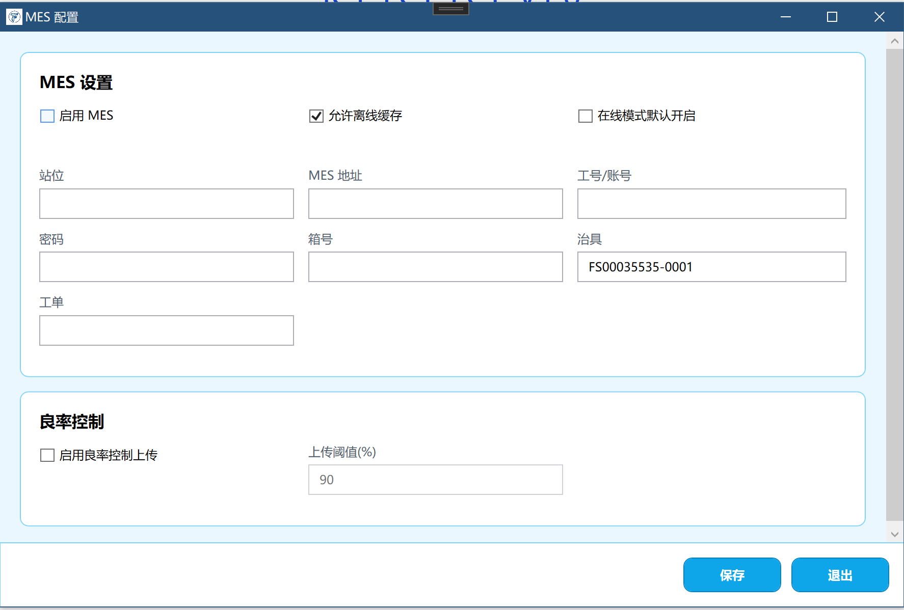

路径：配置管理 > MES 与插件 > MES 配置

MES 配置用于控制是否启用 MES、是否允许离线缓存、是否默认在线，以及维护站位、账号、治具、工单和良率控制。

### 7.1 MES 设置

| 配置项 | 说明 |
| --- | --- |
| 启用 MES | 开启后系统可执行 MES 卡关、在线切换和结果上传。 |
| 允许离线缓存 | MES 不通时允许离线缓存，具体执行能力取决于所选 MES 插件。 |
| 在线模式默认开启 | 软件启动后默认进入 MES 在线模式。生产环境需谨慎开启。 |
| 站位 | 当前测试站位，卡关和上传时使用。 |
| MES 地址 | 通用 MES 地址。部分插件会使用插件配置中的接口 URL 覆盖该地址。 |
| 工号/账号 | MES 登录或上传时使用的操作员工号。 |
| 密码 | MES 登录密码。 |
| 箱号 | 箱号或辅助编号。 |
| 治具 | 当前治具编号。 |
| 工单 | 当前生产工单号。 |

### 7.2 良率控制

| 配置项 | 说明 |
| --- | --- |
| 启用良率控制上传 | 开启后，FAIL 结果上传 MES 前会检查当前良率。 |
| 上传阈值(%) | 当前良率低于该阈值时，系统禁止上传 FAIL 到 MES，并在运行日志提示。 |

### 7.3 底部按钮

| 按钮 | 说明 |
| --- | --- |
| 保存 | 保存 MES 配置。 |
| 退出 | 放弃本次修改。 |

## 8. 插件配置

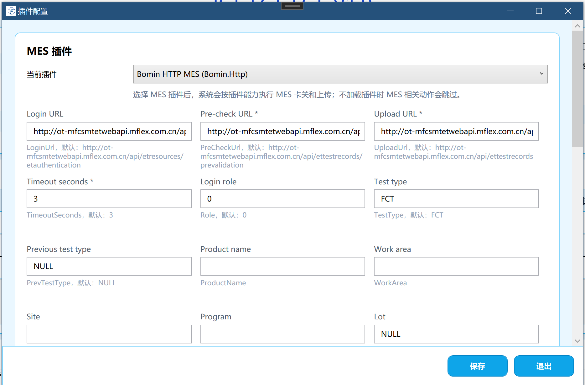

路径：配置管理 > MES 与插件 > 插件配置

插件配置用于选择客户 MES 插件和结果导出插件。不同插件会显示不同参数。

### 8.1 MES 插件区域

| 配置项 | 说明 |
| --- | --- |
| 当前插件 | 当前使用的 MES 插件。不选择插件时，MES 卡关和上传会跳过。 |
| Login URL | 登录接口地址，Bomin 等需要登录的插件使用。 |
| Pre-check URL | 测试前卡关接口地址。带 `*` 表示必填。 |
| Upload URL | 测试结果上传接口地址。带 `*` 表示必填。 |
| Timeout seconds | MES 请求超时时间，单位秒。 |
| Login role | 登录角色，部分客户 MES 使用。 |
| Test type | MES 使用的测试类型，例如 FCT、ICT。 |
| Previous test type | 前站测试类型。 |
| Product name | MES 产品名称。 |
| Work area | 车间或区域。 |
| Site | 厂区或站点。 |
| Program | 测试程序或产品名。 |
| Lot | 流程单或批次。 |

### 8.2 常见 MES 插件

| 插件 ID | 用途 |
| --- | --- |
| Bomin.Http | 博敏 HTTP MES，支持登录、卡关和上传。 |
| SwiftMom.Http | SwiftMOM HTTP MES，支持登录、卡关和上传。 |
| JiaLianYi.CareerRule | 嘉联益 CareerRule MES，通过客户库接口执行卡关和上传。 |
| SuzhouWeiXin.Http | 苏州维信 HTTP MES，GET 卡关、POST 上传。 |
| SuzhouJiaLianYi.LuEnZe.Http | 苏州嘉联益（卢恩泽）HTTP MES。 |

### 8.3 导出器插件区域

该截图显示的是 MES 插件区域，导出器插件在同一页面下方，需要向下滚动查看。

| 配置项 | 说明 |
| --- | --- |
| 当前导出器 | 不选择客户导出插件时使用默认 CSV、DCL、CsvMes；选择客户插件后只执行该客户导出插件。 |
| CSV目录 / PASS CSV目录 / FAIL CSV目录 | 结果 CSV 保存路径。 |
| DCL目录 | DCL 文件保存路径。 |
| CsvMes目录 | CsvMes 文件保存路径。 |
| CSV文件前缀 | 导出文件名前缀。 |
| TesterID / 治具编号 | 导出文件中记录的治具或测试人员字段。 |
| Config / 料号 / 产品名称 | 客户要求写入导出文件的产品或配置字段。 |
| Holder / Slot | 客户文件格式中的 Holder、Slot 字段。 |
| 软件版本 | 写入导出文件的软件或测试程式版本。 |

### 8.4 底部按钮

| 按钮 | 说明 |
| --- | --- |
| 保存 | 保存插件选择和参数。 |
| 退出 | 放弃本次修改。 |

## 9. MES 调试工具

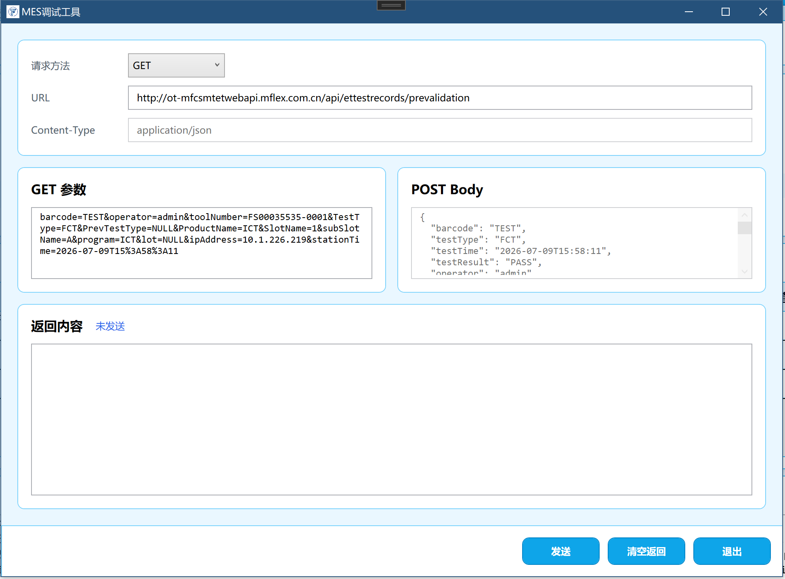

路径：配置管理 > MES 与插件 > MES调试工具

MES 调试工具用于工程师手动测试 MES 接口，不建议操作员在生产中随意发送请求。

| 功能/配置 | 说明 |
| --- | --- |
| 请求方法 | 选择 GET 或 POST。GET 使用 GET 参数；POST 使用 POST Body。 |
| URL | 请求地址。通常为卡关接口或上传接口。 |
| Content-Type | POST 请求体格式，默认 `application/json`。 |
| GET 参数 | GET 请求的参数字符串。系统可根据当前配置生成默认卡关参数。 |
| POST Body | POST 请求体。系统可根据当前配置生成默认上传 JSON。 |
| 返回内容 | 显示 MES 返回数据或异常信息。 |
| 发送 | 发起请求。 |
| 清空返回 | 清空返回内容和状态。 |
| 退出 | 关闭调试工具。 |

使用建议：调试前先确认当前 URL、条码、工号、治具、测试类型、产品名是否为测试数据，避免误向生产 MES 写入结果。

## 10. 用户配置

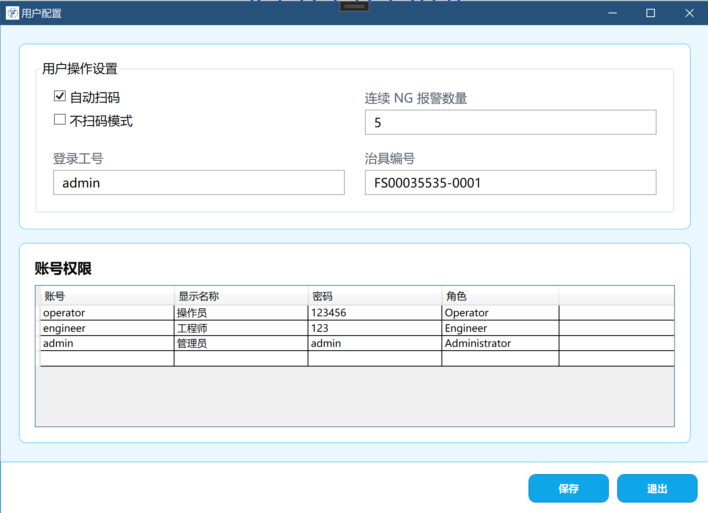

路径：账号管理 > 用户配置

### 10.1 用户操作设置

| 配置项 | 说明 |
| --- | --- |
| 自动扫码 | 开启后系统会自动触发扫码枪。 |
| 手动扫码模式 | 勾选后不再自动触发扫码枪，等待操作员手动触发扫码；扫码结果仍显示在主界面 SN 框中。 |
| 不扫码模式 | 开启后不依赖扫码枪，系统生成 `NOSCAN` 开头的条码用于流程测试或特殊场景。 |
| 连续 NG 报警数量 | 连续 FAIL 达到该数量时，系统弹窗报警并写入日志。 |
| 登录工号 | 当前操作员工号，可用于 MES 上传和调试默认参数。 |
| 治具编号 | 当前治具编号，可用于 MES 上传、导出文件和文件命名。 |

### 10.2 账号权限

| 列 | 说明 |
| --- | --- |
| 账号 | 登录用户名。 |
| 显示名称 | 登录后状态栏显示名称。 |
| 密码 | 登录密码。 |
| 角色 | 权限角色，例如 Operator、Engineer、Administrator。 |

### 10.3 底部按钮

| 按钮 | 说明 |
| --- | --- |
| 保存 | 保存用户设置和账号权限。 |
| 退出 | 放弃本次修改。 |

## 11. 数据分析

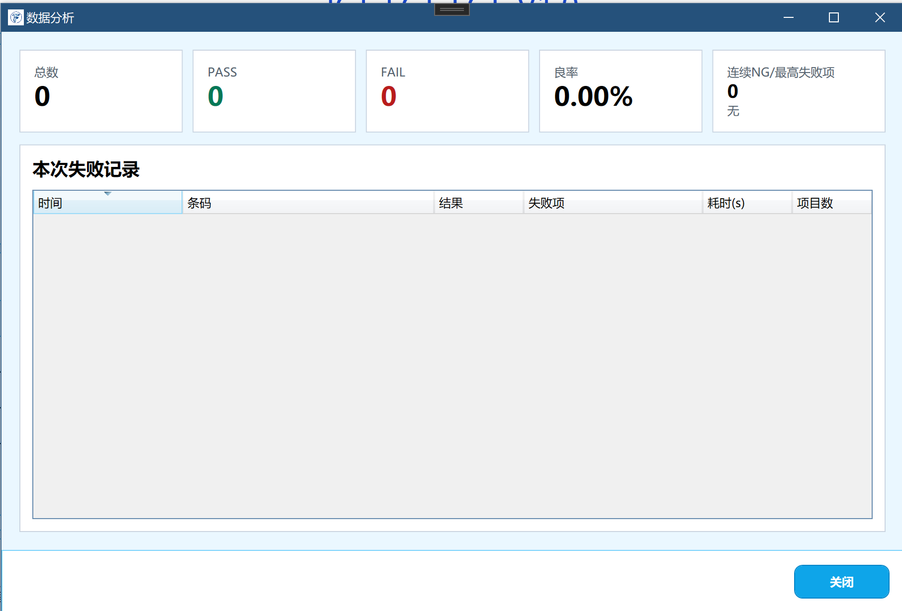

路径：运行数据 > 数据分析

数据分析页面用于查看当前软件运行期间的生产统计和失败记录。

| 区域/字段 | 说明 |
| --- | --- |
| 总数 | 当前统计周期内总测试数量。 |
| PASS | 当前 PASS 数。 |
| FAIL | 当前 FAIL 数。 |
| 良率 | PASS / 总数。 |
| 连续NG/最高失败项 | 显示当前连续 NG 数和失败次数最高的测试项。 |
| 本次失败记录 | 显示本次运行记录。表格列包括时间、条码、结果、失败项、耗时、项目数。 |
| 关闭 | 关闭数据分析窗口。 |

注意：该页面统计的是当前运行期间数据。换线、换工单或重新统计时，可在主界面点击“清空良率”。

## 12. 测试项配置

路径：配置管理 > 测试流程 > 测试项配置

当前截图目录中未包含测试项配置页面截图，后续可补充该截图到 `images` 文件夹并在本节加入图片。

测试项配置用于维护测试项目列表、顺序、上下限、单位和点位。

| 按钮/列 | 说明 |
| --- | --- |
| 新增 | 新增一条测试项。 |
| 删除 | 删除选中的测试项。 |
| 上移 | 将选中测试项向前移动。 |
| 下移 | 将选中测试项向后移动。 |
| 顺序 | 测试项排序。 |
| 测试项目 | 测试项名称，应与下位机返回项目匹配。 |
| 下限 / 上限 | 判定限值。 |
| 单位 | 测试单位。 |
| 点位A / 点位B | 测试点位信息。 |
| 保存 | 保存测试项配置。 |
| 退出 | 放弃本次修改。 |

操作建议：换线或导入客户方案后，应检查测试项目数量、名称、顺序、上下限是否符合现场程序。

## 13. 软件帮助

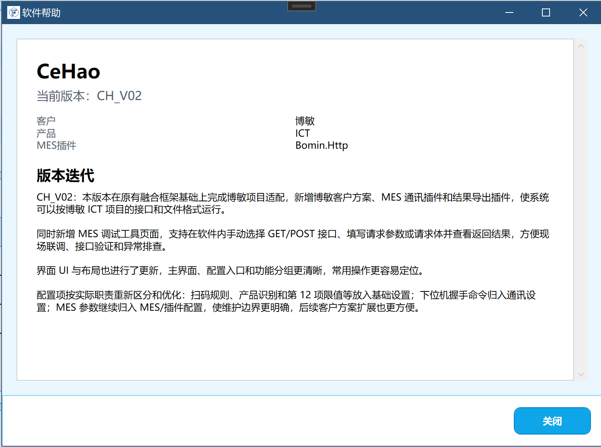

路径：帮助 > 软件帮助

| 区域/字段 | 说明 |
| --- | --- |
| CeHao | 软件名称。 |
| 当前版本 | 当前软件版本，例如 CH_V02。 |
| 客户 | 当前客户名称。 |
| 产品 | 当前产品名称。 |
| MES插件 | 当前使用的 MES 插件。 |
| 版本迭代 | 当前版本更新内容说明。 |
| 关闭 | 关闭帮助窗口。 |

## 14. 日常操作流程

### 14.1 开班前检查

1. 登录系统。
2. 查看主界面标题，确认客户、产品、测试类型和测试程式正确。
3. 查看扫码枪、下位机、MES 状态灯。
4. 确认站位、工单、治具编号。
5. 确认测试项目表中项目、上下限和单位正确。
6. 点击或确认扫码枪、下位机已连接。
7. 需要 MES 在线生产时，点击 MES 状态灯切换在线。
8. 点击“清空良率”，开始新班次或新批次统计。

### 14.2 正常测试

1. 放置产品或治具。
2. 扫描产品条码。
3. 系统显示 SN 并进行条码校验。
4. 在线模式下系统执行 MES 卡关。
5. 下位机开始测试并返回测试结果。
6. 系统显示 PASS 或 FAIL。
7. FAIL 时查看 FAIL项、测试项目红色行和运行日志。
8. 系统自动导出结果文件，并在在线模式下上传 MES。

### 14.3 换线或换工单

1. 管理员导入对应客户方案，或工程师手动修改配置。
2. 检查基础配置、通讯设置、MES 配置和插件配置。
3. 保存配置。
4. 重新连接扫码枪和下位机。
5. 确认 MES 是否需要在线。
6. 清空良率。
7. 使用首件或测试条码确认流程正常。

## 15. 常见异常与处理

| 现象 | 可能原因 | 处理方法 |
| --- | --- | --- |
| 扫码枪红灯未连接 | COM 口错误、扫码枪未上电、串口被占用、TCP 参数错误。 | 检查通讯设置，点击状态灯重连或使用“测试扫码枪连接”。 |
| 下位机红灯未连接 | COM 口、波特率、IP、端口错误，下位机未启动。 | 检查通讯设置和设备状态，使用“测试下位机连接”。 |
| 扫码后无反应 | 条码长度/前缀不符合规则，自动扫码未开启，下位机未收到启动命令。 | 检查基础配置中的条码规则和通讯设置中的触发/OK 命令。 |
| MES 无法在线 | MES 未启用、插件未选择、URL 错误、账号密码错误、网络不通。 | 检查 MES 配置和插件配置，用 MES 调试工具验证接口。 |
| MES 卡关失败 | 条码未过前站、工单/站位/治具错误、MES 返回业务失败。 | 查看运行日志和 MES 返回内容，按现场 MES 流程处理。 |
| 测试项目为空 | 未配置测试项，下位机未返回测试项，请求测试项命令错误。 | 检查测试项配置和通讯设置中的请求测试项命令。 |
| 导出文件未生成 | 保存路径不存在、无权限、导出插件参数错误。 | 检查基础配置保存路径和插件配置中的导出路径。 |
| 良率不正确 | 未清空上一批统计，调试数据计入统计。 | 换线、换工单或开班前点击“清空良率”。 |
| 连续 NG 报警 | 连续失败数量达到配置阈值。 | 停止生产，检查治具、线材、测试程序、下位机和产品状态。 |

## 16. 截图清单

| 界面 | 图片文件 |
| --- | --- |
| 登录界面 | `images/8d1a5c95-1bc4-4095-beb1-6829723e464e.png` |
| 主界面 | `images/c0718a79-f28c-4337-be12-ec67f8cc3daf.png` |
| 导入客户方案 | `images/4e569ee9-18cb-4364-8b80-222a57a1cd96.png` |
| 基础配置 | `images/0d139cb6-dfe6-45b2-837f-409bc16db4f3.png` |
| 通讯设置 | `images/e387c6bb-8462-428c-8ce8-16a6c90abbb2.png` |
| MES 配置 | `images/8d2afceb-f6aa-4cc2-a393-55e0dde1a9a0.png` |
| 插件配置 | `images/3b1f7a4d-334a-49e5-b506-9fda8b438f5e.png` |
| MES 调试工具 | `images/eeef5e4f-7855-423c-aa32-441c4682d60e.png` |
| 用户配置 | `images/a384dc20-9582-4e08-b80a-f1b2aa6b9f8d.png` |
| 数据分析 | `images/95d195d2-477a-487d-92aa-d5978b8c7f23.png` |
| 软件帮助 | `images/c0d2a6af-dcbe-4955-8983-c83d4227727b.png` |

后续若补充“测试项配置”截图，可放入 `images` 文件夹，并在第 12 节增加对应图片。
